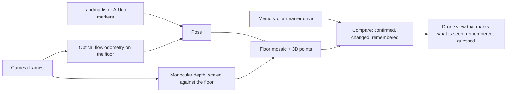
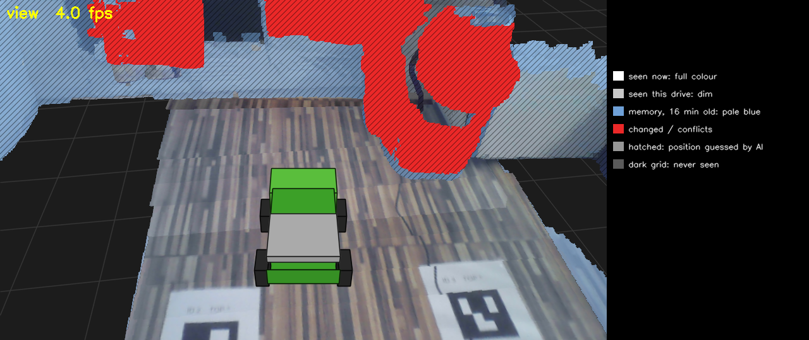
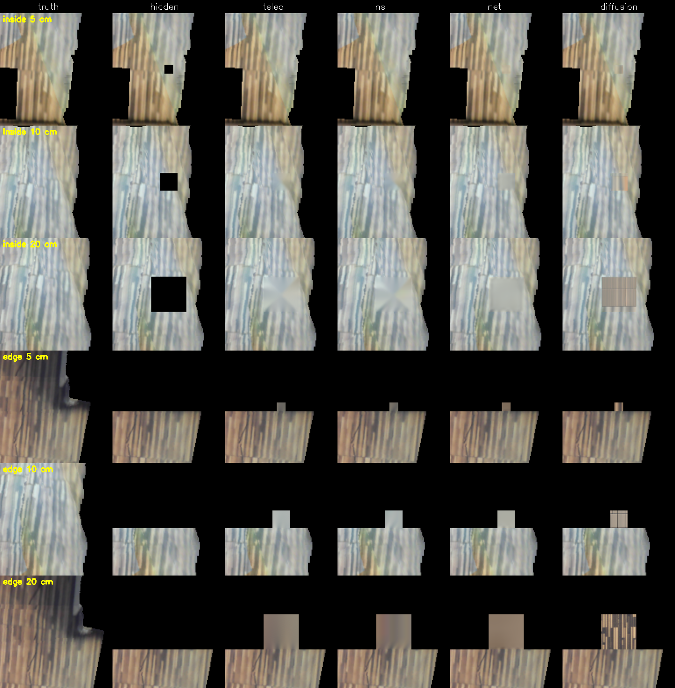

# See-Through Camera

**A drone view built from a car's own cameras that shows the floor under the car from what the front camera
has already seen, and says how much to trust every part of the picture.**

The front camera sees the ground before the car drives over it. If that view is projected onto the ground and
remembered together with the car's position, the car can later "see" underneath and behind itself. This
project builds that, then adds 3D obstacles from monocular depth and the memory of an earlier drive, and
marks what is seen now, what is only remembered and what is guessed.

The "car" is a toy truck carrying a laptop (RTX 3050, 4 GB) with two cheap cameras, pushed by hand around one
home. The inspiration was the public talk around Tesla's FSD "Reality View". This project is not affiliated
with Tesla, does not know how Tesla does it, and does not try to copy it.

## The idea in one table

| What you see | What it means |
|---|---|
| Full colour | A camera sees it right now |
| Slightly dim | Seen during this drive, now out of frame |
| Pale blue | Only remembered from an **earlier** drive, with its age |
| Red | Memory and the cameras disagree (moved, gone or new) |
| Hatched | The position was **guessed** by a depth model, not measured |
| Dark grid | Never seen. Nothing is invented there |

Memory is not a fact. A remembered object is drawn differently from a seen one, and it turns red when the
camera looks through the place where it used to be.

## How it works



1. **Calibration.** A chessboard gives lens distortion and the camera pose above the floor.
2. **Floor projection.** Pixels become centimetres. The car "sees" under and behind itself because it
   remembers the floor it saw ahead.
3. **Position.** Lucas-Kanade optical flow on floor points, corrected by ArUco markers, or by natural visual
   landmarks (SIFT points triangulated from an earlier drive).
4. **3D without stereo.** [Depth Anything V2 Small](https://github.com/DepthAnything/Depth-Anything-V2)
   gives relative depth. The floor geometry is known, so the scale is fitted against it every frame. Pixels
   above the floor become coloured points instead of being smeared onto the floor.
5. **Three threads.** Pose, mapping and drawing run separately, so a slow depth model does not freeze the view.

## Results

All numbers come from replaying recordings at their real pace or offline, in **one home**, on one laptop.
They show what happened in these runs, not what will happen elsewhere.

| What | Result |
|---|---|
| Floor measurements after calibration | within 1.4 % |
| Odometry error after 158 cm without a marker | 2.6 cm, 0.8° |
| Live drone view, two cameras | 8.0 to 9.3 fps, map updated 1.4 times per second |
| Live view with memory of an earlier drive | 10.6 fps, pose 13.5 of ~15 fps, new content lags 0.7 s |
| Memory shown ahead of the car at the start of a drive | 1.34 m² of floor |
| Remembered objects vs. seen again (6 minutes later) | median 1.0 cm, 90th percentile 6.0 cm |
| People kept out of the floor map (YOLO segmentation) | wrongly painted area 0.47 % → 0.05 % |
| Automatic walls from monocular depth | 1.4 to 1.9 cm on one cupboard, 6 to 14 cm on two other objects |

### A drive where something had changed

Memory from one drive, then a drive 16 minutes later with the same position-from-landmarks setup. A bin had
been taken away in between: its remembered points turned red as the camera looked through the spot. Some
other red patches may be false alarms; we did not verify them one by one. This run averaged 7.0 fps (dropping
much lower close to the cupboard), successful fixes were only 37 of 101, and position error was 0.3 cm median,
1.4 cm max.



*Pale blue is memory, red is a conflict, hatching marks positions guessed by the depth model.*

### Position without markers

The landmark map is built from one drive and tested on another. Everything within 22 cm of every marker is
removed before matching. Error is measured against the marker-based pose.

| Memory → test drive | Median / max error | Successful fixes |
|---|---|---|
| A → B | 0.4 / 2.8 cm | 73 of 92 |
| B → A | 0.3 / 1.3 cm | 105 of 131 |
| A → C | 0.3 / 0.8 cm | 34 of 82 |

Read this carefully: the memory's coordinates still come from the markers, the reference is itself
odometry pulled towards markers (centimetre-level accuracy), the drives are minutes apart in the same light,
and most landmarks are the pattern of one laminate floor.

## What did not work

This is probably the most useful part.

### Redrawing the whole view with a diffusion model

SD-Turbo, image-to-image over our drone view, at three strengths. It produced pleasant kitchens that were
not ours.

| | ArUco markers still readable |
|---|---|
| Our measured render | 564 of 564, 0.3 cm median position error |
| After diffusion (every strength) | **0 of 564** |

### Cleaning the render with a one-step fixer

| Method | Colour error on hidden real frames (lower is better) | Markers readable |
|---|---|---|
| No fixer | 27.8 | 88 of 88 |
| NVIDIA Difix (research licence), ~7 s per frame | 28.6 | 80 of 88, small text became fake letters |
| Small third-party net trained on street scenes | 31.7 | 41 of 88, turned the kitchen grey |

### Training our own small fixer

A ~3M parameter U-Net trained on pairs of (our render, real hidden frame). Error barely moved (15.2 → 15.1
on its own test pairs) while readable markers dropped from 88 to **3**. A single error number would have
called this a success.

### Training a net to fill floor that was never seen

A 4.9M parameter U-Net, trained on the project's own floor maps with a whole strip of floor held out.
Mean absolute error on the held-out strip:

| Hole | cv2 Telea | cv2 NS | Our net | SD-Turbo |
|---|---|---|---|---|
| inside, 5 cm | 8.9 | 8.2 | 10.1 | 13.3 |
| inside, 20 cm | 14.2 | 14.6 | 13.8 | 28.1 |
| beyond the edge, 5 cm | 11.1 | 11.6 | 15.3 | 37.7 |
| beyond the edge, 20 cm | 19.1 | 18.1 | 19.7 | 33.3 |



The net learned to paint a smooth average and does **not** beat classical inpainting. SD-Turbo paints sharp
stripes that are not the real ones. So never-seen floor stays black. A likely cause is the pixel loss with
very little data (a few square metres), but we did not test that.

### Smaller lessons

- Removing "ghost" points by carving along camera rays helped a little (smeared floor 3.9 % → 3.2 %) but was
  five times slower, so it is off by default.
- A vibrating laptop lid and a poor USB camera limit quality more than resolution does.
- A laptop GPU reaches 86 to 90 °C within a minute of load. Compare timings only from a similar start
  temperature.
- When a result looks too good, check for leaks. Our first landmark test could still see the printed marker
  sheets.

## Challenges and open problems

- **No stereo, no wheel encoders.** Depth is a model's guess and side slip of a hand-pushed toy is unmodelled.
- **Narrow cameras** (66° and 58° horizontal): a lot of the drone view is never seen.
- **Moving objects** can be flagged, not predicted.
- **Change detection raises some false alarms.** Not every red patch is a real change.
- **Long-term memory** is untested: other light, other days, other seasons, many drives.
- **Outdoors** is untested.

## Running it

Python 3.10, an NVIDIA GPU, Windows (the camera capture uses MSMF; other systems are untested).

```powershell
py -3.10 -m venv .venv
.\.venv\Scripts\pip install -r requirements.txt
.\.venv\Scripts\python src\check_env.py
```

You need your own calibration and recordings; none are included (they show a private home).

```powershell
.\.venv\Scripts\python src\make_chessboard.py
.\.venv\Scripts\python src\calibrate.py lens --camera 0
.\.venv\Scripts\python src\calibrate.py floor --camera 0
.\.venv\Scripts\python src\make_markers.py
.\.venv\Scripts\python src\localize.py --record
.\.venv\Scripts\python src\live_memory.py --memory <first_recording> --drive <second_recording> --landmarks
```

`<first_recording>` and `<second_recording>` are folder names under `data/odom/`.

Each script explains its options in its header. Code comments and on-screen messages are in **Bulgarian**.
Default recording names inside the scripts refer to our private data; pass your own.

### Things you download yourself

No models or third-party code are included. Get what you need from the source and check its licence.

| What | Where | Put it in | Needed for | Licence |
|---|---|---|---|---|
| Depth Anything V2 Small | [huggingface.co/depth-anything/Depth-Anything-V2-Small-hf](https://huggingface.co/depth-anything/Depth-Anything-V2-Small-hf) | `models/depth-anything-v2-small/` | 3D, memory view | Apache-2.0 |
| Ultralytics + `yolo11n-seg.pt` | [github.com/ultralytics/ultralytics](https://github.com/ultralytics/ultralytics) (`pip install ultralytics`) | `models/yolo11n-seg.pt` | optional `--objects` (keep people out of the map) | **AGPL-3.0**: if you use this option, its terms apply |
| SD-Turbo (fp16) | [huggingface.co/stabilityai/sd-turbo](https://huggingface.co/stabilityai/sd-turbo) | `models/sd-turbo/` | diffusion experiments | Stability AI |
| Difix | [huggingface.co/nvidia/difix](https://huggingface.co/nvidia/difix) | `models/difix/` | fixer experiment | NVIDIA, non-commercial |
| Small U-Net layout (`rv/nf.py`) | [github.com/faceninjahq/diy-tesla-fsd-reality-view](https://github.com/faceninjahq/diy-tesla-fsd-reality-view) | `src/nanofix.py` (see below) | the two training experiments | code Apache-2.0, weights research only |

`nf_train.py`, `fill_train.py` and `difix_eval.py --fixer nf` import a small module `nanofix.py` that is **not
shipped**, because its network is adapted from the repository above. To run them, write that file yourself:
a class `_Net(ch=(32, 64, 128, 256), cin=7)` with `enc`, `mid`, `dec` and `out` as in their `rv/nf.py`, and for
the fixer experiments a `NanoFix(path)` wrapper that maps a BGR image to a BGR image.

## Map of the code

| Area | Files in `src/` |
|---|---|
| Calibration and projection | `calibrate.py`, `projection.py`, `birdseye.py`, `measure.py`, `calibrate_rig.py` |
| Position | `motion.py`, `tags.py`, `localize.py`, `landmarks.py` |
| Mapping | `mapper.py`, `static_map.py`, `depth3d.py`, `surfels.py`, `dynamic.py` |
| Memory and honest view | `memory_drive.py`, `live_memory.py` |
| Live view and simulator | `live.py`, `sim.py` |
| Experiments, including the failed ones | `redraw.py`, `difix.py`, `difix_eval.py`, `nf_train.py`, `inpaint.py`, `diffuse.py`, `fill_train.py` |

## Licence

The code in this repository is under the [MIT licence](LICENSE). It does not cover the models and libraries
you download.
